# SLSA-provenance-lab
 
Signing an image with Cosign tells you it wasn't modified after signing. It
doesn't tell you what built it, from what source, or on what CI. This repo is a
small, working setup that generates real SLSA Build Level 3 provenance
(`slsa-github-generator`), verifies it (`slsa-verifier`), and probes where
verification does and doesn't react to tampering.

## TL;DR
 
- **What works as expected.** An image pushed to the registry outside the
  pipeline is rejected by `slsa-verifier verify-image` (no matching
  attestations). The legitimately built image passes.
- **What I tried and what actually happened.** I tried to feed `verify-image` a
  forged provenance file through `--provenance-path`. The result was `PASSED`,
  and it was identical for `/dev/null`. In this setup the file's contents did
  not change the verdict (E3, E4).
- **What this does *not* show.** It is not a verifier bypass: the `PASSED`
  verdict most likely refers to the genuine attestation stored in the registry,
  not to my forged file. It also does not show that the signature check catches
  tampered content, because that check was never exercised by my test.
- **Cause: not established.** I have not read the verifier's source. See
  [Hypotheses](#hypotheses-why-did-the-file-not-matter).
  
Scope of every statement below: an image built by
`generator_container_slsa3.yml@v2.0.0`, the `verify-image` command, the image
referenced by digest. I did not record the exact `slsa-verifier` version or the
run date, so treat the results as a single observation, not as a statement about
a specific release.

## Stack
 
- basic FastAPI app
- GitHub Actions: build → push to GHCR → generate provenance
- [`slsa-github-generator`](https://github.com/slsa-framework/slsa-github-generator) `generator_container_slsa3.yml@v2.0.0`
- [`slsa-verifier`](https://github.com/slsa-framework/slsa-verifier) for verification
- Cosign, for comparison


## Pipeline
```yaml
jobs:
  build:
    runs-on: ubuntu-latest
    permissions:
      contents: read
      packages: write
    outputs:
      digest: ${{ steps.build.outputs.digest }}
      image: ${{ steps.image.outputs.image }}
    steps:
      - uses: actions/checkout@v4
      - uses: docker/login-action@v3
        with:
          registry: ghcr.io
          username: ${{ github.actor }}
          password: ${{ secrets.GITHUB_TOKEN }}
      - id: image
        run: echo "image=ghcr.io/${{ github.repository_owner }}/slsa-lab-app" >> "$GITHUB_OUTPUT"
      - id: build
        uses: docker/build-push-action@v6
        with:
          context: ./app
          push: true
          tags: ${{ steps.image.outputs.image }}:${{ github.sha }}
 
  provenance:
    needs: [build]
    permissions:
      actions: read
      id-token: write
      packages: write
    uses: slsa-framework/slsa-github-generator/.github/workflows/generator_container_slsa3.yml@v2.0.0
    with:
      image: ${{ needs.build.outputs.image }}
      digest: ${{ needs.build.outputs.digest }}
      registry-username: ${{ github.actor }}
    secrets:
      registry-password: ${{ secrets.GITHUB_TOKEN }}
```

Both jobs live in one file, connected via `needs:`. That is fine: `provenance`
is not code I wrote, it is a call to a pinned reusable workflow owned by the
SLSA project. GitHub runs it as a separate job under its own OIDC identity (the
token's `job_workflow_ref` points at `generator_container_slsa3.yml`, not at my
workflow), so a compromised `build` job cannot read that job's token or forge
its identity.

**Limit of this guarantee.** The `provenance` job receives the image digest from
the `build` job's outputs. A compromised `build` job can therefore still produce
a malicious image; the provenance will then honestly describe *that* build.
Isolation protects the integrity of the provenance, not the contents of the
image.

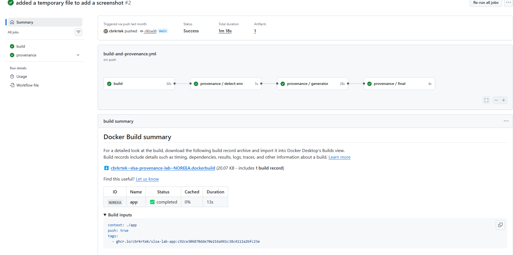


## Experiments
 
| ID | What | Observed |
|----|------|----------|
| E1 | Verify the real image, correct `--source-uri` / `--source-branch` | PASS |
| E2 | Verify an image pushed manually (no attestation) | FAIL: `no matching attestations` |
| E3 | Real image + forged `--provenance-path` | PASS |
| E4 | Real image + `--provenance-path /dev/null` | PASS |
 
E2 is the only negative control I ran: it shows the verifier can return FAIL in
this setup. It is a weak control for E3/E4, because it fails for a different
reason (no attestation at all) than the one I was probing (a wrong claim inside
an attestation). See [What I did not do](#what-i-did-not-do).


### E1: verifying the real image
 
```bash
IMAGE="ghcr.io/cbrkrtek/slsa-lab-app"
DIGEST="sha256:1c70c20db0f36b09dd0954a096050631fe3c41fa3f33e27443b4469a75a478da"
 
slsa-verifier verify-image "${IMAGE}@${DIGEST}" \
  --source-uri github.com/cbrkrtek/slsa-provenance-lab \
  --source-branch main
```
 
```
Verified build using builder "https://github.com/slsa-framework/slsa-github-generator/.github/workflows/generator_container_slsa3.yml@refs/tags/v2.0.0" at commit c92ce306870dde70e216a961c38c4112a2bfc23e
PASSED: Verified SLSA provenance
```

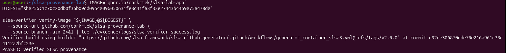


For comparison, Cosign on the same image:

```bash
cosign verify-attestation \
  --type slsaprovenance \
  --certificate-identity-regexp ".*" \
  --certificate-oidc-issuer https://token.actions.githubusercontent.com \
  "${IMAGE}@${DIGEST}"
```

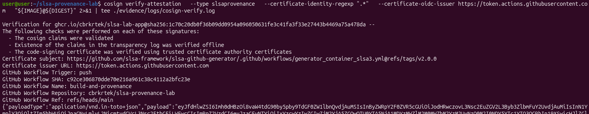

Note that `".*"` accepts any identity, so this command is deliberately lax.
Cosign *can* enforce identity: with a strict `--certificate-identity` (or a
tight regexp) it would reject certificates from other workflows. The difference
I'm illustrating is about defaults and ergonomics. `slsa-verifier` expects you
to say which source you trust; `cosign` leaves that decision to the flags you
write.

### E2: image pushed outside the pipeline
Simulating stolen registry credentials: push a build directly, skip CI.
```bash
docker build -t ghcr.io/cbrkrtek/slsa-lab-app:manual-push ./app
docker push ghcr.io/cbrkrtek/slsa-lab-app:manual-push
 
DIGEST_MANUAL=$(crane digest ghcr.io/cbrkrtek/slsa-lab-app:manual-push)
 
slsa-verifier verify-image "ghcr.io/cbrkrtek/slsa-lab-app@${DIGEST_MANUAL}" \
  --source-uri github.com/cbrkrtek/slsa-provenance-lab \
  --source-branch main
```

```
FAILED: SLSA verification failed: no matching attestations:
```

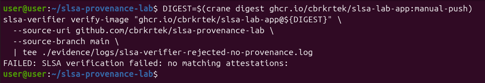

No provenance was ever attached to that digest, so there is nothing to verify.
This is what "image pushed outside CI" looks like from the verifier's side.
Always verify by digest: tags are mutable and can be re-pointed by anyone with
write access.

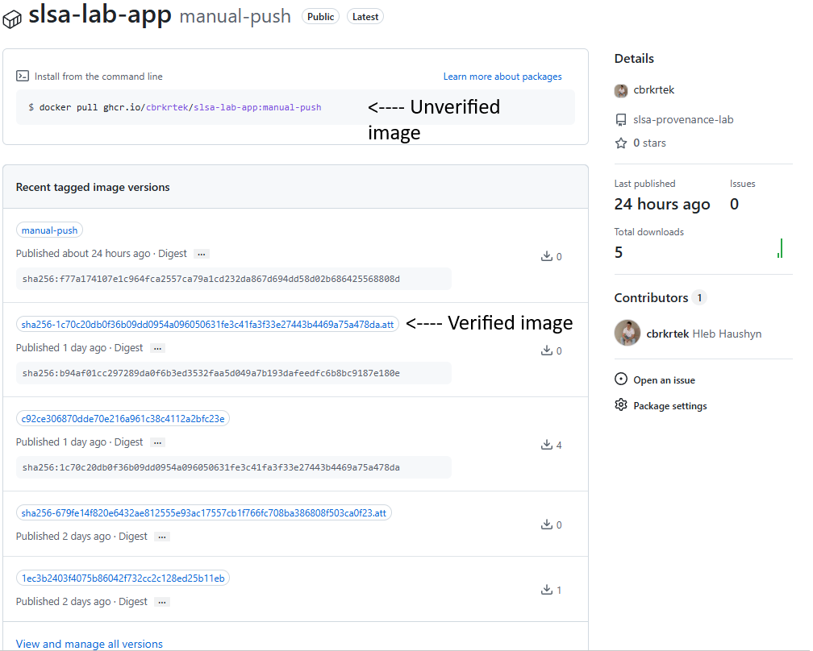

### E3–E4: forged provenance passed via `--provenance-path`

I downloaded the real provenance:

```bash
cosign download attestation "${IMAGE}@${DIGEST}" \
  | jq -r '.payload' | base64 -d | jq '.' > evidence/json/real-provenance.json
```
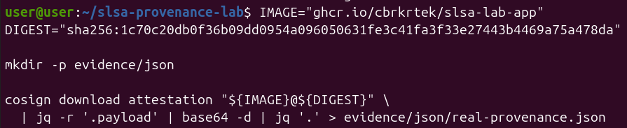

```bash
jq '{
  subject: .subject,
  builder: .predicate.builder.id,
  buildType: .predicate.buildType,
  source: .predicate.invocation.configSource
}' evidence/json/real-provenance.json
```

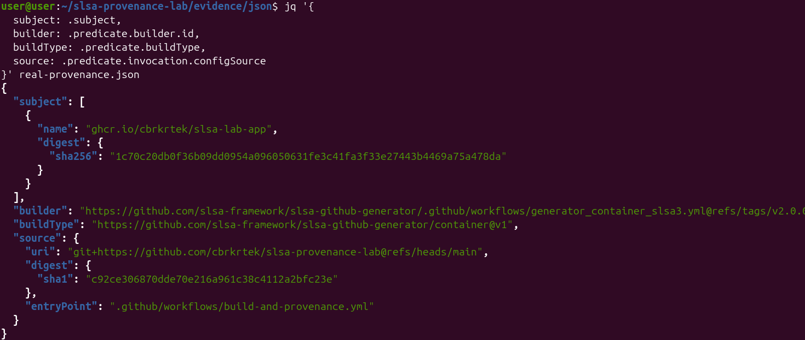

I then changed `source.uri` and `source.digest.sha1` to point at a fake
repository and left everything else untouched:

```diff
<         "uri": "git+https://github.com/cbrkrtek/slsa-provenance-lab@refs/heads/main",
---
>         "uri": "git+https://github.com/attacker/evil-repo",
<           "sha1": "c92ce306870dde70e216a961c38c4112a2bfc23e"
---
>           "sha1": "deadbeefdeadbeefdeadbeefdeadbeefdeadbeef"
```

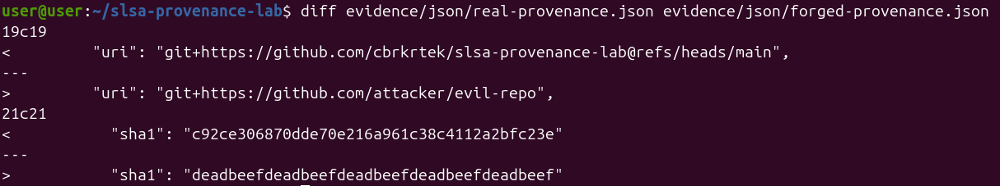

Note that I edited the *decoded payload*. The original DSSE envelope and
signature were not re-created, so this file is not a valid envelope at all. It
is a plain JSON statement.

**Hypothesis going in:** the verifier would read this file, notice that the
signature does not match, and reject it.

```bash
slsa-verifier verify-image "${IMAGE}@${DIGEST}" \
  --source-uri github.com/cbrkrtek/slsa-provenance-lab \
  --provenance-path evidence/json/forged-provenance.json
```

```
PASSED: Verified SLSA provenance
```

Control: the same command with `/dev/null`.

```bash
slsa-verifier verify-image "${IMAGE}@${DIGEST}" \
  --source-uri github.com/cbrkrtek/slsa-provenance-lab \
  --provenance-path /dev/null
```

```
PASSED: Verified SLSA provenance
```

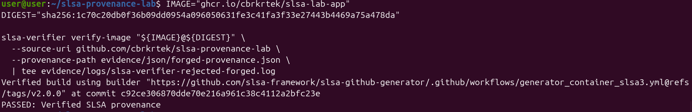

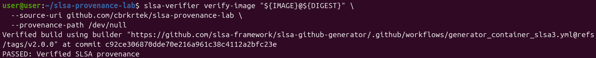


### What can and cannot be concluded


**Observed.** In E3 and E4, with this verifier version, this image and this
command, changing the content of the file passed to `--provenance-path` (forged
JSON vs. empty file) did not change the output. The printed builder and commit
match the *real* build, not my forged values.

**Interpretation (not proven).** The simplest reading is that the verdict was
produced from the attestation stored in the registry and not from my local
file. That means:
 
- I did **not** bypass verification: the forged content was not what got
  verified.
- I did **not** test whether the signature check detects tampered content. That
  test would require getting a modified attestation into the place the verifier
  actually reads from (the registry), which is a different and harder
  experiment.


**Not claimed.** I do not claim that `--provenance-path` is a no-op in general.
I tested one path (GitHub Actions / `slsa-github-generator`), and I did not
check the documentation for the scenarios the flag is intended for. The
behaviour I saw could be correct for this path and simply surprising.


### Hypotheses: why did the file not matter?

I did not investigate the cause. These are the candidate explanations, not
findings:
 
- **H1.** The flag is not read at all for `verify-image` on this path.
- **H2.** The flag is read but does not influence the verdict.
- **H3.** The flag is used, and my experiment was incomplete (for example, it
  may need a valid, signed envelope rather than decoded JSON).
Ways to tell them apart, none of which I have done: read the `verify-image`
implementation in the `slsa-verifier` repository; check the issue tracker for an
existing report; pass a nonexistent path and a non-JSON file and see whether the
tool complains; pass an untouched, undecoded envelope from
`cosign download attestation`.
 
If the cause turns out to be H1 or H2, the issue is one of usability: a flag
that is accepted but has no effect on the verdict can mislead users into
believing they verified a local file. That would belong in an issue or a
documentation fix. A real security discrepancy should go through the project's
private reporting process, not a public write-up.

## What I did not do

- Negative controls with a wrong `--source-uri`, a wrong `--source-branch`, or a
  forged file combined with a wrong `--source-uri`. Without them I can't fully
  rule out a stand that is more permissive than I assume.
- Read the verifier's source or search its issue tracker.
- Record the verifier version and run date.
- Test `--provenance-path` with any builder other than
  `slsa-github-generator`.
- Test whether the signature check detects a tampered attestation that is
  actually stored in the registry.

### Rekor entry

```bash
rekor-cli search --sha 1c70c20db0f36b09dd0954a096050631fe3c41fa3f33e27443b4469a75a478da
```
 
```
Found matching entries (listed by UUID):
108e9186e8c5677ad7a17a74a009d6b79592942feae0e683c4f685928957b137f31ba1a0b949b22d
```

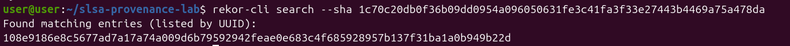
 
This shows that the transparency log has an entry associated with that digest.
To confirm what the entry contains, run
`rekor-cli get --uuid <UUID> --format json`.
 
## Signing vs provenance
 
| | Cosign signature | SLSA provenance (verified with `slsa-verifier`) |
|---|---|---|
| Answers | Has this been modified since it was signed, and by which identity? | Which builder produced it, from which source, and with which entry point? |
| Source / commit | Not part of a plain signature | Recorded in the provenance; checked against the flags you pass (`--source-uri`, `--source-branch`, …) |
| Builder identity | Readable from the certificate; enforced only if you set strict identity flags | Verified against the builder identified in the provenance; trusted builders are checked by the tool |
| If the *build* job is compromised | The signature may still be valid | Provenance is still produced honestly by the isolated job; the *image* may be malicious |
| Local file overriding verification (`verify-image`) | n/a | Not observed in E3/E4; cause not established |
 
## What SLSA provenance does and does not guarantee
 
**It supports claims such as:**
 
- The artifact with this digest was produced by this builder workflow.
- It was built from this repository, ref and commit.
- The provenance was signed under the builder's identity and is recorded in a
  public transparency log.
**It does not tell you:**
 
- That the source code is free of vulnerabilities or backdoors.
- That the dependencies pulled at build time are trustworthy.
- That the build job's *outputs* weren't tampered with before they reached the
  provenance job (see "Limit of this guarantee" above).
- That anything is safe to run. `PASSED` means "the provenance matches what you
  asked for", and your `--source-uri` / `--source-branch` flags define what
  you asked for.
## Reproducing
 
```bash
git clone https://github.com/cbrkrtek/slsa-provenance-lab
cd slsa-provenance-lab/verification
./verify-legit.sh <git-sha-tag>
```
